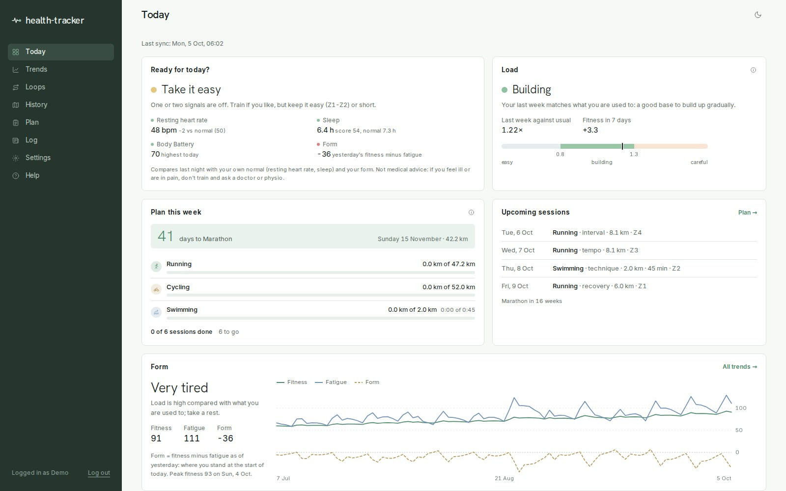
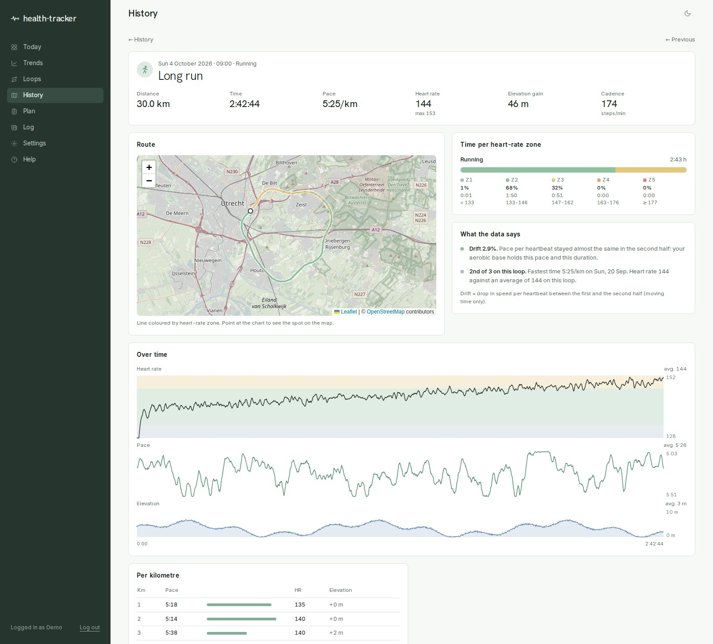
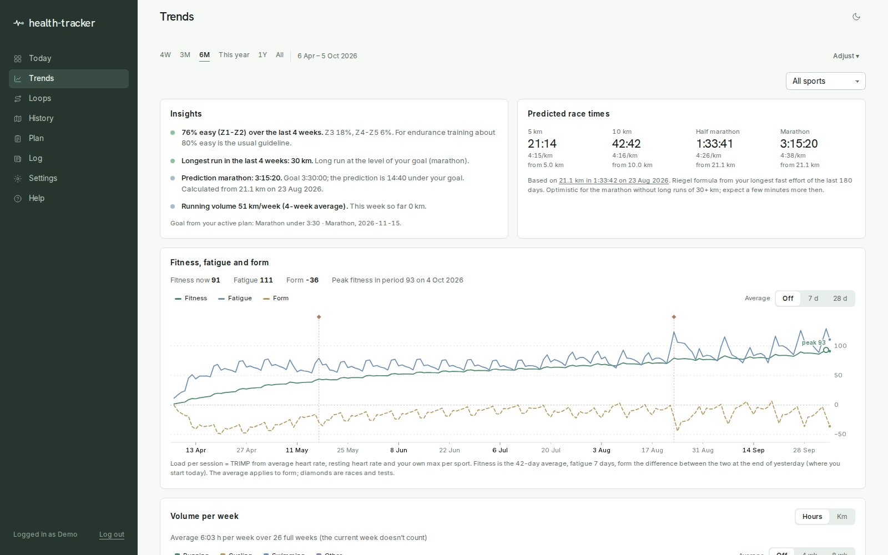
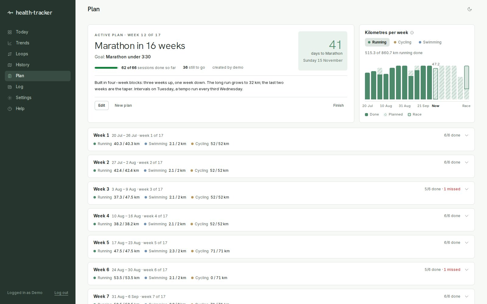
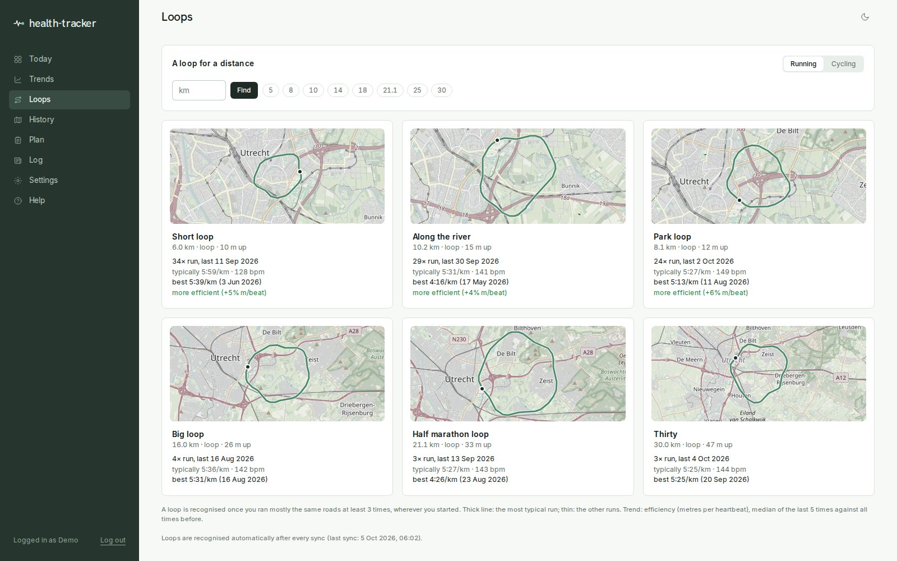
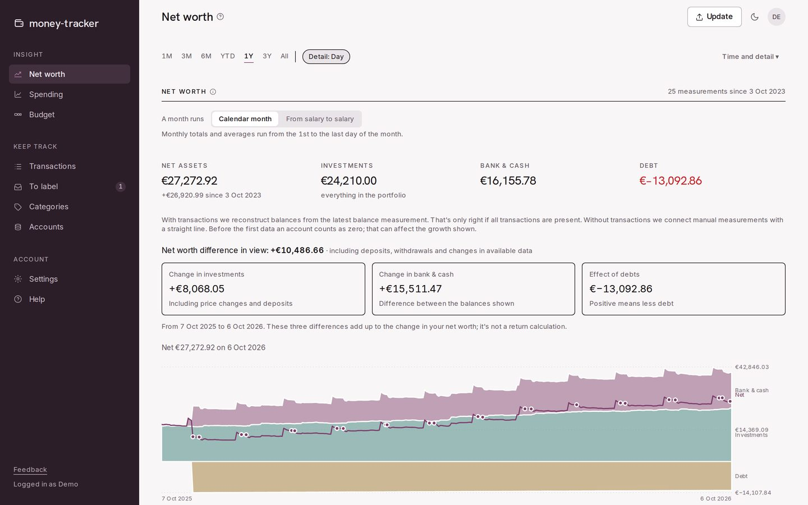
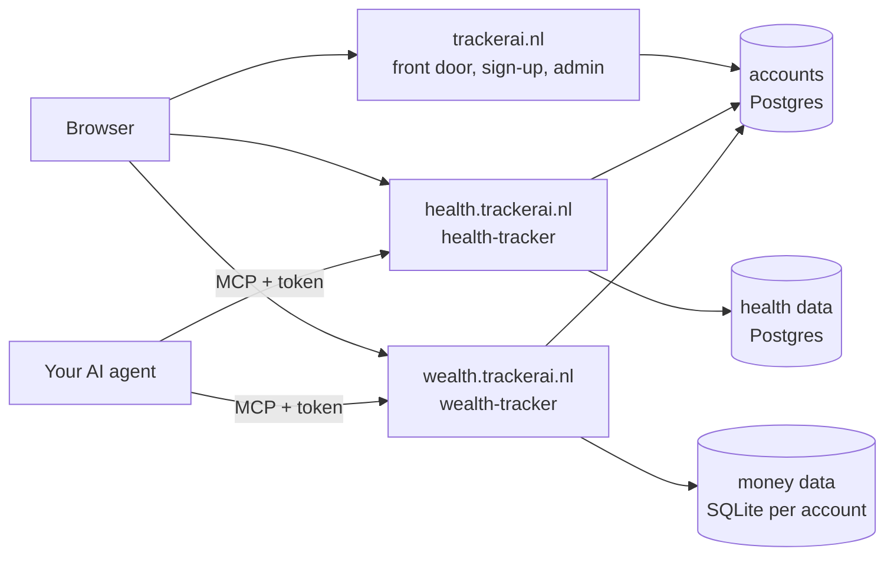

# trackerai

**Your health and your wealth. Measured, understood, yours.**

trackerai is two calm, private trackers that do the bookkeeping of your life for you: **health-tracker** for training,
sleep and recovery, and **wealth-tracker** for your money and net worth. Your data comes in by itself where it can
(Garmin, Wahoo, your bank) and by a simple upload where it can't (Apple Health, DeGiro). Each tracker turns it into
dashboards you can read at a glance, and you can connect your own AI agent to ask about it, plan with it, or let it keep
the books.

You sign up once at [trackerai.nl](https://trackerai.nl) and choose health, wealth or both. One account and one login
open every tracker you use.

All screenshots show synthetic demo accounts (`scripts/seed_demo.py` in each tracker), never a real person's data.
Some wealth-tracker screenshots were taken before the rename and still show its old names (stock-tracker,
money-tracker).

## What it does

### health-tracker: train with your own numbers

Runs, rides, swims, sleep and recovery come in from Garmin every morning (rides from Wahoo too), or from an Apple Health
export. Everything is computed with **your own heart-rate zones per sport**, not the watch's generic ones.

- **Today:** a readiness check against your own baseline, the next sessions from your plan, form (fitness, fatigue,
  freshness) and time per zone. A second tab shows last night's sleep and body.
- **Every session** with its route coloured by heart-rate zone, a linked heart-rate, pace and altitude chart, splits,
  laps and how it compares with earlier runs on the same loop. A run straight after a swim or ride counts as one
  multisport session, and is not compared with a fresh run.
- **Trends** over weeks and months: form, VO2max, volume per sport, pace at a low heart rate, predicted race times and
  records.
- **Loops:** your regular routes are recognised automatically, and "a loop of X km" suggests a route for any distance.
- **A plan next to reality:** each planned session is matched to what you did, with done, missed and zone compliance.

| | |
|---|---|
|  |  |
|  |  |

More in [health-tracker/README.md](health-tracker/README.md).

### wealth-tracker: see where your money goes, and what it becomes

Your bank accounts, spending, debts and investments together, so your net worth is one number you understand. A
read-only bank connection (PSD2, through Enable Banking) brings in transactions and balances; it can never pay. Or
upload exports from ING or bunq, and your DeGiro export for the portfolio.

- **Net worth, explained:** investments, bank and cash, and debt over time, and each month's change split into what you
  saved, what the market did, and what you paid off.
- **Spending and budgets:** most transactions are labelled automatically; label the rest once and a rule remembers it.
  Budgets per group, fixed costs, months that can run from salary to salary, and when you pay for friends or a partner
  only your own share counts.
- **Your portfolio:** what you own and what it returns (time- and money-weighted), against the market, dividends, and
  what your ETFs really hold.

| | |
|---|---|
|  |  |
|  |  |

More in [wealth-tracker/README.md](wealth-tracker/README.md).

### Both trackers

- **Your own agent.** Each tracker is an MCP server. Connect any AI agent that speaks MCP (Claude, ChatGPT, Codex,
  Copilot, Cursor, …) with a token you create and control: read-only, or allowed to write too. In health it reads your
  training and writes analyses and plans; in wealth it reads your overview and, when you allow it, labels transactions
  and sets budgets. No premium subscription is needed to talk to your own data.
- **No lock-in.** Your dashboards live in the trackers, not inside a chat app. Switch agents, or use none at all: your
  pages and history stay.
- **One secure sign-in.** One trackerai account for every tracker ([packages/accounts](packages/accounts)), with
  two-step login by authenticator app or by a code sent to your email, and "stay logged in" on your own devices.
- **Private by design.** Each tracker keeps your data apart from everyone else's, and you can export or delete your
  account yourself. Your Garmin password goes only to Garmin; stored keys and sessions are encrypted.
- **Look around first.** A short tour on first visit, with example data, before your own data is in.
- **Open code, run it yourself.** Everything is in this repository, and both trackers can be self-hosted on your own
  server or a mini PC at home.
- English and Dutch, light and dark mode, installable as an app on your phone.

### trackerai.nl

The front door ([packages/marketing](packages/marketing), served by wealth-tracker's frontend for the trackerai.nl
hosts) explains both trackers, takes sign-ups (choose health, wealth or both; the welcome mail confirms the address)
and logs you in for every tracker at once. Admins manage accounts, sign-up, invitations and two-step login for both
trackers in one place at [trackerai.nl/admin](https://trackerai.nl/admin).

One session cookie on the parent domain holds on every tracker. Who you are (login, two-step login, language, which
trackers you use) is shared; your data is not: health data stays in health-tracker's database, money data in
wealth-tracker's, and an agent token only ever reaches the tracker that made it.

## Repository

| Directory | App | Live at |
|---|---|---|
| [`health-tracker/`](health-tracker) | Training, sleep and recovery (Garmin, Apple Health) with a coach over MCP | health.trackerai.nl |
| [`wealth-tracker/`](wealth-tracker) | Money and portfolio (formerly stock-tracker): bank import, spending, budget, net worth | wealth.trackerai.nl |
| [`trackerai/`](trackerai) | trackerai.nl: the front door with sign-up and login, and the admin page for every tracker (`web`, `api`) | trackerai.nl (from step 11.3) |
| [`packages/`](packages) | **Shared code**: design system, i18n runtime, layout shell, backend security, the public `marketing` pages | — |

Each app directory is the full history of its old repository
([health-tracker](https://github.com/Joost-Jansen/health-tracker),
[stock-tracker](https://github.com/Joost-Jansen/stock-tracker)), moved into its subdirectory. `git log --
health-tracker/` shows that history; `git blame` works as before.

## Where things go

- Code that both apps use, or will use, goes in `packages/`. That includes the public pages for trackerai.nl and the
  product pages of both apps (`packages/marketing`).
- Code for only one app goes in that app's directory.
- Moving code from an app into `packages/` is the direction of travel; see [docs/PLAN.md](docs/PLAN.md) for the order.

## Running and testing

The two frontends and `packages/` are one npm workspace: run `npm ci` once at the repo root (one `package-lock.json`),
then work inside an app's frontend as before. The web images build from the repo root, e.g.
`docker build -f health-tracker/web/Dockerfile .` and `docker build -f wealth-tracker/frontend/Dockerfile .`.

Each app is still tested and run on its own; see its README:

- `health-tracker/`: `python -m pytest -q tests`; in `web/`: `npx tsc --noEmit -p .`, `npm run check:i18n`.
- `wealth-tracker/`: `TZ=Europe/Amsterdam python -m pytest backend/tests -q`; in `frontend/`: `npx tsc --noEmit -p .`,
  `npm run check:i18n`, `npm test`.

CI runs one workflow per app, triggered by changes in that app, in `packages/` or in the workspace files
([.github/workflows](.github/workflows)). Each also builds the app's image.

## Deploying

- **Railway** deploys from this repository's `main` (since 2026-10-08). Each service builds only when its own paths
  change (its watch paths):

  | Railway service | Dockerfile (build context) | Live at |
  |---|---|---|
  | health-web | `health-tracker/web/Dockerfile` (repo root) | health.trackerai.nl |
  | health-api | `health-tracker/api/Dockerfile` (repo root) | the API behind it |
  | health-sync | `health-tracker/Dockerfile.sync` (`health-tracker/`) | daily Garmin sync |
  | stock-tracker / money | `wealth-tracker/frontend/Dockerfile` (repo root) | wealth.trackerai.nl, www.trackerai.nl |
  | stock-tracker / api | `wealth-tracker/backend/Dockerfile` (repo root) | the API behind it |

  The old repositories no longer deploy anything; work happens here.
- **Self-hosting on a mini PC:** see `health-tracker/docs/SELF_HOSTING.md` and `wealth-tracker/docs/SELF_HOSTING.md`.
  The shared edge (Caddy and the Cloudflare tunnel) is in `health-tracker/deploy/edge`, and moves to a top-level
  `deploy/` in step 3 of the plan.
