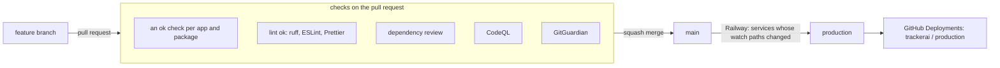

# Branches, checks and deploys

`main` is what runs in production: Railway builds every service from it. Work happens in short-lived branches that
reach `main` by pull request once their checks are green. Nothing is pushed to `main` directly.

## Branches

- **Feature branches** (`nutrition-photo`, `fix-login`, ...): one change each, a pull request into `main`. They are
  deleted when the pull request merges.
- **`main`**: production. A pull request merges as one squash commit (title and body from the pull request), so the
  history stays linear and every commit on `main` is one reviewed change.

An admin can still merge past the rules in an emergency (`gh pr merge --admin`); it is meant to stay rare.

## Checks

One workflow per part of the repository, in `.github/workflows/`:

| Workflow | Tests | Required check |
|---|---|---|
| `health-tracker` | backend (pytest), frontend (tsc, i18n, build), both images | `health-tracker ok` |
| `wealth-tracker` | backend on SQLite and Postgres, frontend, the image | `wealth-tracker ok` |
| `trackerai` | the front door's API and image | `trackerai ok` |
| `trackerai-web` | the front door's site and image | `trackerai-web ok` |
| `accounts`, `websec`, `ai` | the shared Python packages in `packages/` | `accounts ok`, `websec ok`, `ai ok` |
| `lint` | ruff (check and format), ESLint and Prettier over the whole repository | `lint ok` |
| `dependency review` | no new dependency with a known high or critical vulnerability | `dependency review` |
| `CodeQL` | static analysis of the Python and TypeScript code, also weekly | not required, see Security |

Every Python suite runs on Postgres, as production does: its job has a Postgres service (`TEST_DATABASE_URL`) and
`packages/testing` gives each test a database of its own. Locally the same server comes from `compose.dev.yml`.

A push to `main` runs an app's workflow only when its paths changed. A pull request runs every workflow: a first job,
`changes`, compares the pull request with its base and the jobs only run when the same paths changed; otherwise they
are skipped. The last job, `<workflow> ok`, always runs and is green when every job passed or was skipped. Those
`ok` jobs are the required checks on `main`: a skipped workflow still reports, so a pull request is never left waiting
for a check that does not run. `lint` is fast enough to run in full on every pull request.

Adding a job to a workflow: give it `needs: changes` and `if: needs.changes.outputs.run == 'true'`, and add it to the
`needs` of `ok`. Adding a workflow: copy that pattern, and add its `ok` check to the branch protection of `main`
(Settings, Branches).

Formatting and lint run locally too: `pre-commit install` once (see [CONTRIBUTING.md](../CONTRIBUTING.md)), or
`ruff check .`, `ruff format --check .`, `npm run lint` and `npm run format:check` before pushing.

## Security

- **CodeQL** scans the Python and TypeScript code on every pull request, on `main` and weekly; findings are in the
  Security tab.
- **Dependabot** opens weekly pull requests for pip, npm, GitHub Actions and Docker: per ecosystem one for minor and
  patch versions and one for major versions. Node and Python majors (the images, `@types/node`) are left to a
  deliberate upgrade with CI on the same version.
- **Dependency review** fails a pull request that adds a dependency with a known high or critical vulnerability.
- **Secret scanning** with push protection refuses a push that contains a known secret format; **GitGuardian** scans
  every pull request as well.
- Vulnerabilities are reported privately, see [SECURITY.md](../SECURITY.md).

## Deploys

Railway (project `trackerai`, environment `production`) builds each service from `main` when a file in its watch
patterns changes:

| Service | Dockerfile | Watches |
|---|---|---|
| `health-api` | `health-tracker/api/Dockerfile` | `health-tracker/api`, `tools`, `scripts`, the shared Python packages |
| `health-web` | `health-tracker/web/Dockerfile` | `health-tracker/web`, `packages/ui`, `packages/marketing`, the npm lockfiles |
| `health-sync` | `health-tracker/Dockerfile.sync` (cron 04:00) | `health-tracker/tools`, its requirements |
| `api` (wealth) | `wealth-tracker/backend/Dockerfile` | `wealth-tracker` (not its frontend or docs), the shared Python packages |
| `wealth-web` | `wealth-tracker/frontend/Dockerfile` | `wealth-tracker/frontend`, `packages`, the npm lockfiles |
| `trackerai-api`, `trackerai-web` | `trackerai/api`, `trackerai/web` | their folder and the packages they use |

A new shared package needs adding to the watch patterns of every service whose image installs it (for example
`packages/ai` for `health-api` and `api`).

Railway's "Wait for CI" setting decides whether a deploy waits for the checks of its commit on `main` to pass first.
