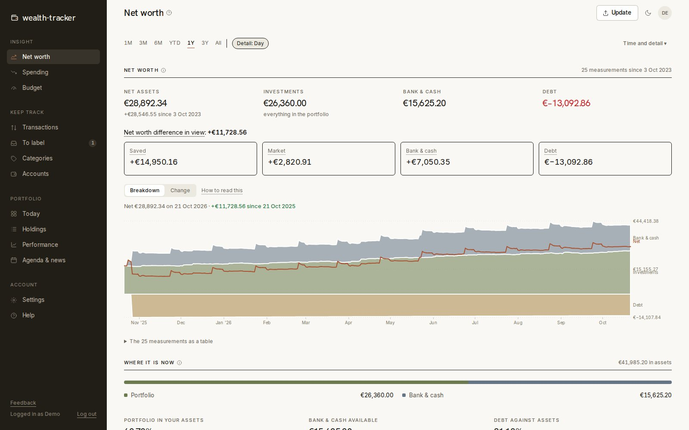
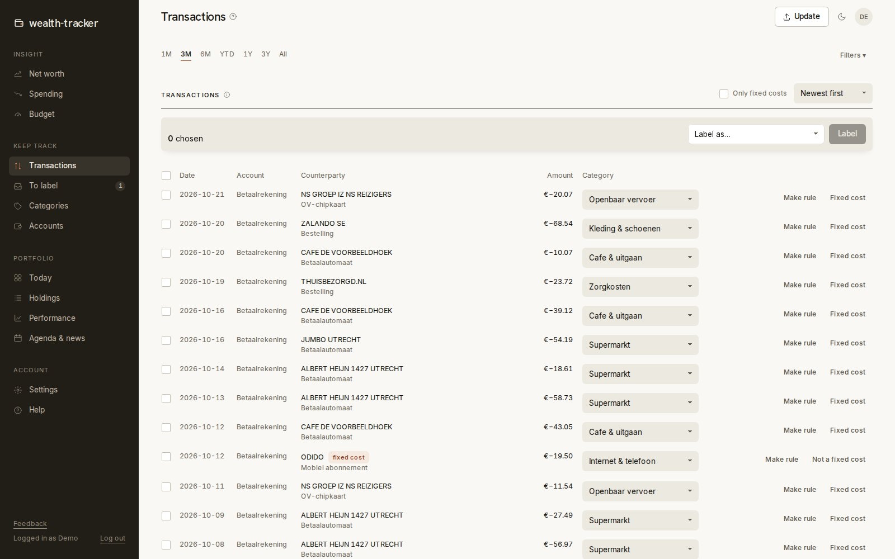
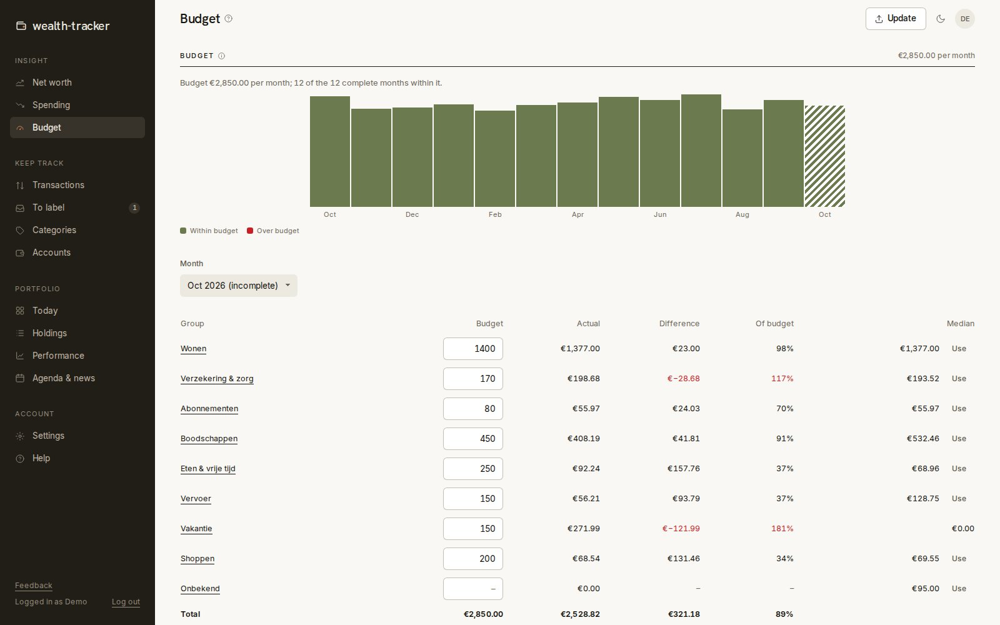
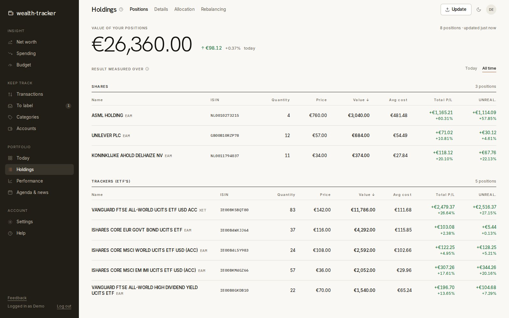
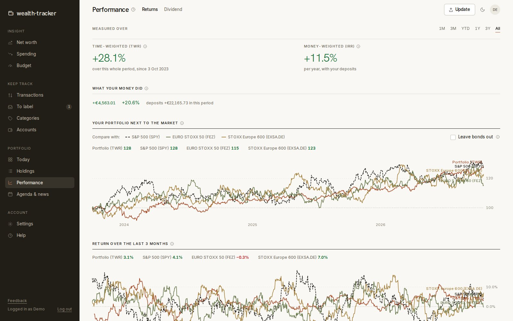
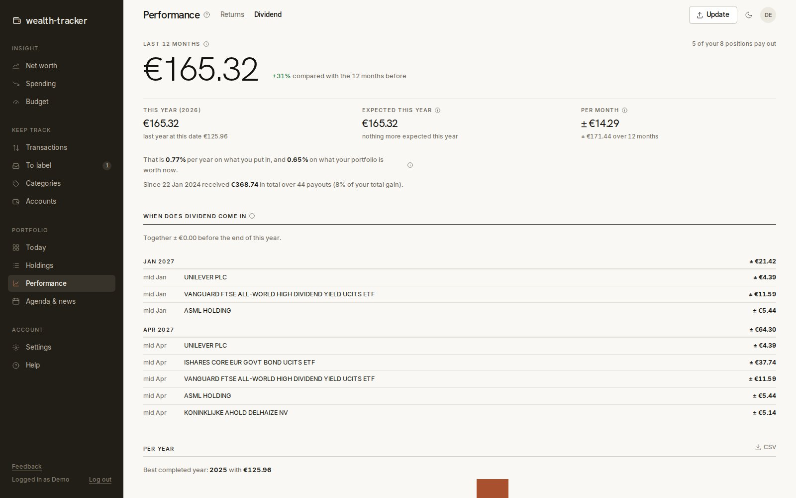
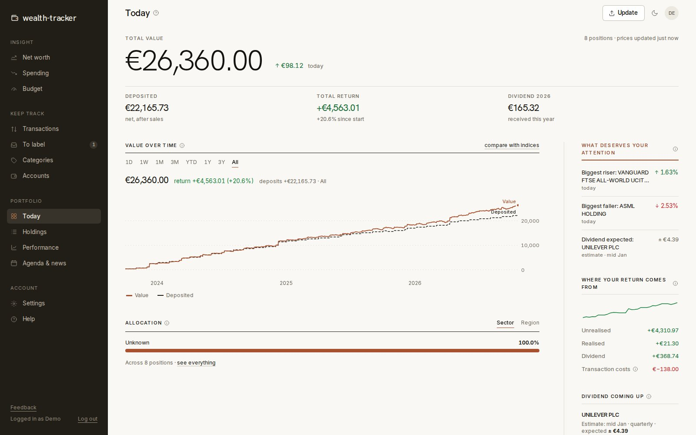
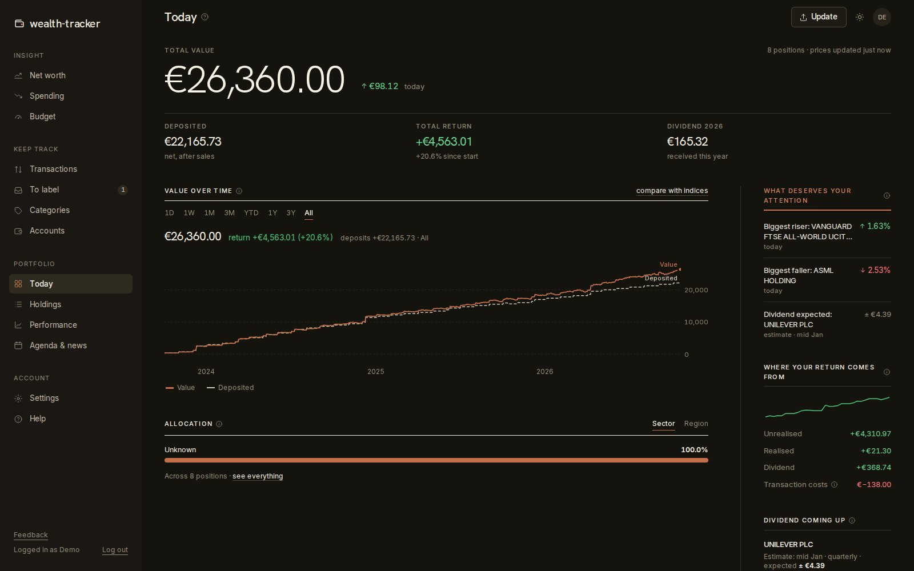
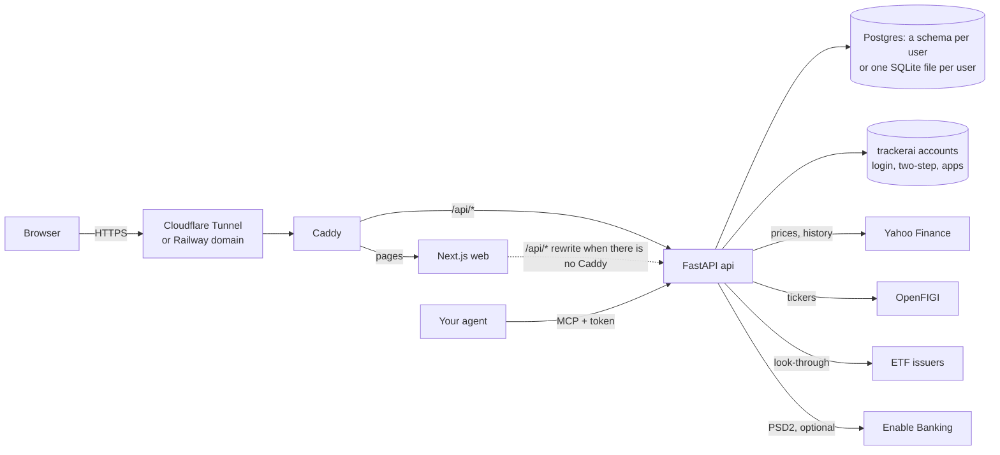

# wealth-tracker

**A dashboard for your money, net worth and long-term investments: your bank comes in by itself, your broker export by
upload, and you see where your money goes and what it becomes.**

Part of [trackerai](../README.md): it runs at wealth.trackerai.nl with a trackerai account, next to
[health-tracker](../health-tracker/README.md). It was called stock-tracker until 2026; the name, the history and the
portfolio side carry on here.



<sub>All screenshots show the demo account from [`scripts/seed_demo.py`](scripts/seed_demo.py): an invented person with a portfolio of real, public ETFs and shares and invented amounts. The price history in these screenshots is simulated, because they were taken without access to market data. Regenerate them with [`scripts/screenshots.mjs`](scripts/screenshots.mjs). The UI speaks English and Dutch; these screenshots are in English. Category names are the user's own data: the standard taxonomy is Dutch, because the labelling rules know Dutch banks and shops, and every category can be renamed.</sub>

wealth-tracker puts your bank accounts, spending, debts and investments together, so your net worth is one number you
understand: what you saved, what the market did, and what you paid off. **Money** connects to your bank over PSD2 (read
only; it can never pay) or imports bank exports (ING, bunq), labels every transaction automatically, and shows spending,
budgets and net worth (investments plus bank balances minus debts). The **portfolio** side turns the transaction and
account exports of DeGiro (a European online broker) into a dashboard with live prices, returns that account for when
you deposited money, dividends, ETF look-through and benchmark comparisons. Your own AI agent can read all of it over
MCP and, when you allow it, keep the books. The interface is in English and Dutch, chosen per account. Every account has
its own database; it runs on Railway, or on a mini PC or Raspberry Pi in Docker.

## Contents

- [Features](#features)
- [Accounts and sign-up](#accounts-and-sign-up)
- [Architecture](#architecture)
- [Notable engineering decisions](#notable-engineering-decisions)
- [Deploy your own](#deploy-your-own)
- [Connect your own agent (MCP)](#connect-your-own-agent-mcp)
- [Feedback](#feedback)
- [Try it locally with demo data](#try-it-locally-with-demo-data)
- [Development](#development)
- [Project structure](#project-structure)
- [Credits](#credits)
- [Disclaimer](#disclaimer)
- [License](#license)

## Features

### Money

- **Accounts.** Bank, savings, cash, broker cash and debts (with an interest and repayment schedule for a student loan).
  Balances over time, and a balance check that explains every difference between measured and computed balances.
- **Import or connect.** CSV exports of ING, ING savings and bunq, or a PSD2 connection through Enable Banking, where each
  user brings their own Enable Banking application and key. Duplicates between an export and the connection are matched.
- **Automatic labelling.** A rule engine with a standard Dutch taxonomy (supermarkets, energy, insurance, transport, ...),
  your own rules, transfers between your own accounts recognised by IBAN, learning from labels you set by hand, and
  optionally a suggestion step through the Anthropic API for what is left (off unless the server has a key and the user
  turns it on; IBANs and card numbers are masked first). Manual labels always win.
- **Spending, budget and fixed costs.** Income and spending over time, per group and category, budgets per group with an
  "are you on track this month" line, fixed costs recognised from their monthly pattern, and a month that can run from
  payday to payday.
- **Net worth, explained.** Investments, bank and cash, and debt in one series, and every month's change split into
  saved, market, bank and cash, and debt.
- **Shared costs.** Money you pay for friends or a partner is not your spending: only your own share counts, in a
  category you choose.
- **Bank on open.** A connected bank is fetched when you open the app and the last fetch is more than six hours old.

| | |
|---|---|
|  |  |

### Portfolio

- **Today.** Total value with today's change (aware of exchange hours and holidays), money put in, total return,
  value over time against deposits (1D to all time), a breakdown of the return into unrealised, realised, dividends and
  costs, a "since your last visit" strip, upcoming dividends and things worth your attention.
- **Positions.** Every holding grouped as shares, ETFs and bonds, with quantity, price, value, average cost,
  total and unrealised result, today or all-time. A detail page per position with its price chart, your buys and sells on
  it, and its dividends.
- **Returns.** Time-weighted (TWR) and money-weighted (IRR) return over any period, and **benchmarks**: your
  portfolio against the S&P 500, EURO STOXX 50 and STOXX Europe 600 since your first purchase, this year and recent months,
  optionally without bonds.
- **Dividends.** Received and expected per month and per fund, yield on cost and on current value, next payments.
- **Allocation.** ETF look-through to the underlying holdings, sectors and regions, read from the
  issuers' own holdings files (iShares, Vanguard and others), with a canary script that warns when a source changes format.
- **News and calendar.** News per holding and for the market (Finnhub, Alpha Vantage), earnings and ex-dividend dates.
- **Rebalancing** (beta). Target split between shares and bonds and what to buy to get there.

Returns, Dividends, Calendar and Rebalancing are beta features an admin switches on per account.

| | |
|---|---|
|  |  |
|  |  |

### Around it

A welcome tour that walks through every page with example data first, help pages, a privacy statement and terms,
feedback with a screenshot, and export or delete your account yourself. English and Dutch: the browser's language at
first, then the choice under Settings, stored with the account. Light and dark mode, and installable as an app on your
phone:



## Accounts and sign-up

Logins are the shared trackerai account ([packages/accounts](../packages/accounts/README.md)), so one account opens
wealth-tracker and health-tracker:

- **Sign-up** happens on trackerai.nl (or this site's `/register`). You choose wealth, health or both, and give an email
  address; a welcome mail brings a code that confirms it before you continue. Signing up for wealth turns Money on.
- **Two-step login** by an authenticator app, by a code sent to your email, or both.
- **Stay logged in** for 30 days on your own devices (`SESSION_DAYS`); untick it on a shared computer.
- **Admins** manage accounts, sign-up (open, an invitation link per person, or closed), invitations and two-step login
  for both trackers at trackerai.nl/admin. What belongs to wealth-tracker alone (beta features per account, the feedback
  inbox) stays on its own admin page. On an empty accounts database the first account to sign up becomes the admin.

**trackerai.nl** itself (the front door with sign-up, login for every tracker and the admin page at `/admin`) is its
own app: [trackerai/](../trackerai), trackerai-web and trackerai-api.

## Architecture

| Layer | Stack |
|---|---|
| Web | Next.js 16 (App Router, standalone server), React 19, TypeScript, Tailwind, TanStack Query, hand-written SVG charts |
| API | Python 3.13, FastAPI, pandas, PyJWT, bcrypt, cryptography (Fernet) |
| Data | Postgres: one `wealth` database with a schema per user (`WEALTH_DATABASE_URL`, `domain/db.py`); without it one SQLite file per user (WAL mode), for self-hosting and the local demo. Logins in the shared trackerai accounts database (Postgres); beta flags in `auth_config.yaml` |
| Market data | `yfinance` (prices and history), OpenFIGI (ISIN to ticker), Tradegate quotes, issuer ETF holdings files, Finnhub and Alpha Vantage (news, optional) |
| Hosting | Two services on Railway, built from the monorepo root, or Docker Compose behind Caddy and a Cloudflare Tunnel on a mini PC or Raspberry Pi |



**Data flow.** A user uploads DeGiro's transaction export and account statement (Excel or CSV). The parsers normalise them
into transactions, dividends and broker cash, de-duplicated by count, so re-uploading an overlapping export is a no-op while
two genuinely identical fills both stay. Each ISIN is resolved to a ticker (Yahoo search and OpenFIGI, checked against the
price you actually paid and the share class) and prices are refreshed on demand and, during exchange hours, by a background
loop. Positions, returns, dividends and charts are computed per request from the user's own database, with slow remote
results (history, holdings files, news) cached in that database. Bank exports go through their own parsers into one
normalised row (spending positive, income negative), then through the labelling engine.

**Auth and multi-user.** Logins are the shared trackerai account: username, password, two-step login (app or email
codes), language, admin and suspended flags, and which trackers an account uses live in the accounts database that every
tracker reaches. Login sets an httpOnly session cookie on the shared parent domain with a signed JWT (HS256,
`ACCOUNTS_SESSION_SECRET`), so one login holds on every tracker. Logins are rate-limited per account (across trackers)
and per IP before the password is checked, so a blocked attempt costs no bcrypt; sign-up is rate-limited too. Every
request resolves the session to the account's data folder and opens that user's own schema (or SQLite file); there is no
shared data table, so one user's queries cannot reach another user's data. A suspended account's session stops working
immediately. `auth_config.yaml` keeps what is wealth-tracker's own (beta flags per account, its admins); a login from
before the shared accounts becomes an account on its first login.

**Secrets.** The private key of a user's Enable Banking connection is encrypted with Fernet (AES-128-CBC + HMAC-SHA256)
using `APP_ENCRYPTION_KEY`, or, without it, a key the server generates once on the data volume (owner-readable only), and it
is never sent back to the browser. API keys (news, Anthropic) are server environment variables, never stored per user.

## Notable engineering decisions

- **A database per user.** Isolation by construction instead of by `WHERE user_id = ?`; deleting an account is deleting a
  folder; a backup is a `tar` of one volume.
- **Outages are not facts.** A price download that returns nothing raises `DataUnavailable` instead of being read as "no
  history", so an outage shows "try again in a few minutes" rather than a flat value line or a 0.00% return, and it is
  never cached.
- **Returns that respect deposits.** Time-weighted return for comparing with indices, money-weighted (IRR) for "what did my
  money do", and a simple return next to them, each explained on the page.
- **Exchange-aware "today".** The day change reads a market calendar, so a weekend or holiday shows no change instead of
  Friday's move again.
- **Labelling with a clear order of certainty.** Manual label, own accounts, rules by priority, learned from your own
  labels, and only then an optional suggestion above a confidence threshold. The standard rules are versioned, so an update
  adds what is new once and never undoes what a user changed.
- **Small, explicit domain modules.** Every domain function takes the database connection as its first argument; routers
  are thin. About 1,400 offline tests (pytest) cover the parsers, returns, labelling, budgets, auth hardening and the API.
- **Built for a 1 GB Raspberry Pi.** Images are built elsewhere and shipped (`deploy/deploy.sh`), containers have memory and
  CPU limits, and only the Caddy proxy publishes a port.

## Deploy your own

### Railway

1. Fork [trackerai-app](https://github.com/Joost-Jansen/trackerai-app).
2. Create a project with two services from the fork, both on branch `main`, both built from the repo root, and a
   Postgres service (the shared accounts and, with `WEALTH_DATABASE_URL`, the users' data in a `wealth` database):

   | Service | Root directory | Dockerfile | Watch paths | Healthcheck | Volume |
   |---|---|---|---|---|---|
   | `api` | `/` | `wealth-tracker/backend/Dockerfile` | `wealth-tracker/**` except `frontend/` and `docs/`, `packages/accounts/**` | `/api/health` | mounted at `/data` |
   | `wealth-web` | `/` | `wealth-tracker/frontend/Dockerfile` | `wealth-tracker/frontend/**`, `packages/**`, `package.json`, `package-lock.json` | `/login` | none |

3. Set the variables from the table below, including the shared account (`ACCOUNTS_*`) with the same values as
   health-tracker. Give only `wealth-web` a public domain; `api` stays on the private network. The front door is
   trackerai/'s (trackerai-web and trackerai-api).
4. Deploy and sign up: on an empty accounts database the first account becomes the admin, and sign-up switches to
   closed. Invite others from the admin page (an invitation link per person, or open sign-up).
5. Connect your bank or upload exports under **Update**, and your DeGiro exports for the portfolio.

Keep `api` at one replica: the data volume (feedback, `auth_config.yaml`) allows one writing machine. Turn on volume backups in Railway.

### A mini PC, a Raspberry Pi or any Docker host

`docker-compose.yml` runs `api` (`stock-api`) and `web` (`stock-web`) on the external docker network `edge`, behind a
shared reverse proxy (Caddy) and a Cloudflare Tunnel for a public HTTPS domain without opening router ports. The full
guide, including the edge, backups and upgrading, is [`docs/SELF_HOSTING.md`](docs/SELF_HOSTING.md).

```bash
git clone https://github.com/<you>/trackerai && cd trackerai/wealth-tracker
cp .env.example .env && chmod 600 .env       # APP_ENCRYPTION_KEY, ACCOUNTS_* (required), PUBLIC_ORIGINS, ...; never commit .env
mkdir -p data
docker network create --subnet 172.30.0.0/24 edge   # once per box
docker compose up -d --build
```

The original Raspberry Pi setup, with its own Caddy on `127.0.0.1:8502` and its own tunnel, is the compose profile `pi`;
there the images are built on another machine and shipped (see `deploy/deploy.sh` and [`docs/DEPLOY.md`](docs/DEPLOY.md)).

### Environment variables

| Variable | Service | Required | What it does | How to get a value |
|---|---|---|---|---|
| `DATA_DIR` | api | Railway: yes | Folder for every user's database and uploads (default `./data` next to the code) | `/data` on Railway |
| `AUTH_CONFIG_PATH` | api | Railway: yes | Location of `auth_config.yaml`, with wealth-tracker's beta flags and admins (default next to the code) | `/data/auth_config.yaml` |
| `ACCOUNTS_DATABASE_URL`, `ACCOUNTS_SESSION_SECRET`, `ACCOUNTS_ENCRYPTION_KEY`, `SESSION_COOKIE_DOMAIN`, `REQUIRE_TOTP` | api | yes (the first three) | The shared trackerai account: the same values on every tracker. See [packages/accounts](../packages/accounts/README.md) | see there |
| `WEALTH_DATABASE_URL` | api | no | The users' data in Postgres instead of one SQLite file each: one schema per user (`domain/db.py`). Empty: SQLite, as before | `postgresql://${{Postgres.PGUSER}}:${{Postgres.PGPASSWORD}}@${{Postgres.RAILWAY_PRIVATE_DOMAIN}}:5432/wealth` |
| `WEALTH_MIGRATE_FROM_SQLITE` | api | for the move | `on`: at startup, copy every user still on SQLite into Postgres and check it (`domain/migrate_pg.py`); a failure stops the start. Off again once everyone is moved | `on` |
| `RESEND_API_KEY`, `MAIL_FROM` (or `SMTP_*`) | api | for sign-up | Sends the welcome mail and login codes; the same on every tracker | a sending-only key from resend.com |
| `PORT`, `HOST` | api, money | Railway: yes | Listen address. `api`: `PORT=8000`, `HOST=0.0.0.0` (not `::`). `web`: `PORT=3000` | as given |
| `API_INTERNAL_URL` | money (build) | Railway: yes | Where Next.js forwards `/api/*`; frozen at build time, so a change needs a rebuild | `http://${{api.RAILWAY_PRIVATE_DOMAIN}}:8000` |
| `RAILWAY_RUN_UID` | api | Railway: yes | Run as root so the container can write to the volume | `0` |
| `TZ` | api | no | Time zone for timestamps (the image uses `Europe/Amsterdam`) | e.g. `Europe/Amsterdam` |
| `COOKIE_SECURE` | api | no | `false` allows the session cookie over plain http, for local development only | `false` locally |
| `PRICE_REFRESH` | api | no | `on` refreshes every account's prices during exchange hours | `on` |
| `APP_ENCRYPTION_KEY` | api | yes | Fernet key that encrypts bank-connection keys and sessions and two-step login secrets; the api refuses to start without it. On an existing install take over `data/.encryption_key` (see docs/SELF_HOSTING.md, Upgrading) | `python -c "from cryptography.fernet import Fernet; print(Fernet.generate_key().decode())"` |
| `PUBLIC_ORIGINS` | api | behind a proxy that changes Host (Railway) | The site's public origin(s), comma-separated: CSRF origin check and the bank's return address | `https://stocks.example.org` |
| `TRUSTED_PROXIES` | api | behind a proxy | IPs/CIDRs whose `CF-Connecting-IP`/`X-Forwarded-For` are believed; empty: none | the `edge` network subnet |
| `PRIVACY_CONTROLLER`, `PRIVACY_CONTACT` | api | recommended | Who runs the installation and how to reach them, on `/privacy` | your name, an e-mail address |
| `FRONT_DOOR_URL` | api | no | The front door the site links to (the trackerai.nl admin page). Default: `https://www.<SESSION_COOKIE_DOMAIN>`; without a shared domain, no link. See [packages/accounts](../packages/accounts/README.md) | `https://www.trackerai.nl` |
| `SESSION_DAYS` | api | no | "Stay logged in": days a session lasts after its last use (default 30), and how long a device that gave the two-step code is not asked for it again | `30` |
| `MAX_UPLOAD_MB`, `UPLOAD_RETENTION_DAYS` | api | no | Largest upload (default 10 MB); days an imported file is kept (default 0: deleted after import) | `10`, `0` |
| `ALLOW_INSECURE_DEFAULTS` | api | development only | `true` allows running without `APP_ENCRYPTION_KEY` | never in production |
| `ANTHROPIC_API_KEY` | api | no | Enables the optional labelling suggestions (still off per user until they turn it on) | from the Anthropic console |
| `FINNHUB_API_KEY`, `ALPHAVANTAGE_API_KEY` | api | no | News feeds; without a Finnhub key the news comes from Yahoo Finance (no key needed) | free keys from finnhub.io and alphavantage.co |
| `OPENFIGI_API_KEY` | api | no | Higher rate limit for ISIN-to-ticker lookups | free key from openfigi.com |
| `NTFY_TOPIC_URL` | api | no | Push notification (ntfy) when a position cannot be priced, and when someone sends feedback (only the kind and number, never the text) | your ntfy topic URL |
| `ENABLEBANKING_API_URL` | api | no | Another Enable Banking endpoint (sandbox) | from Enable Banking |
| `TUNNEL_TOKEN` | cloudflared | profile `pi` only | Cloudflare Tunnel connector token, in `.env` | Cloudflare Zero Trust, Networks, Tunnels |

## Connect your own agent (MCP)

The `api` is also an MCP server, so your own AI agent (Claude, ChatGPT, Codex, Copilot, Gemini, …) can read your
portfolio, net worth and spending, and (if you allow it) keep the books: label transactions, set budgets, keep labelling
rules, categories and settings, enter balances and add transactions. Your dashboards stay on the site, not in a chat
app, so you can switch agents or use none, and no premium subscription is needed to talk to your own data. A token only
reaches wealth-tracker; health-tracker has its own.

1. Under **Settings → Agents**, make a token and choose what it may do:
   - **Read**: read everything, change nothing.
   - **Read and write**: also label transactions, set budgets, add and delete labelling rules, rename, move and
     retype categories, change the month layout, the shared-costs category and fixed costs, enter a balance and add a
     manual transaction. Never uploads, deleting transactions, categories or accounts, creating accounts, bank
     connections or admin; the allow-list is `AGENT_WRITES` in `backend/app/deps.py`.
2. Connect it. Any MCP client works: the server speaks streamable HTTP (stateless, JSON answers) with the token as
   `Authorization: Bearer <token>`, or in the URL (`https://<your-domain>/api/mcp/<token>`) for a client that only takes a URL. The Agents
   page shows the steps for the assistant you pick, with your token already filled in. Open the one you need:

<details><summary><b>Claude</b> (app, claude.ai, Claude Code)</summary>

At claude.ai/customize/connectors, Add custom connector, URL `https://<your-domain>/api/mcp/<token>`. Once per account: it then works in the
Claude app, on claude.ai and in Claude Code logged in with that account. Only Claude Code with an API key instead of a
claude.ai login needs its own entry:

```bash
claude mcp add --transport http --scope user wealth-tracker https://<your-domain>/api/mcp --header "Authorization: Bearer <token>"
```
</details>

<details><summary><b>ChatGPT</b></summary>

On the web, switch on Developer mode under Settings (Apps or Connectors, Advanced), create a connector with URL
`https://<your-domain>/api/mcp/<token>` and authentication "No authentication" (the token is in the URL).
</details>

<details><summary><b>Codex</b> (CLI and IDE extension)</summary>

In `~/.codex/config.toml`:

```toml
[mcp_servers.wealth-tracker]
url = "https://<your-domain>/api/mcp"
http_headers = { "Authorization" = "Bearer <token>" }
```
</details>

<details><summary><b>GitHub Copilot</b> (VS Code, CLI)</summary>

Each keeps its own list. In VS Code: Command Palette, "MCP: Open User Configuration", and add under `servers`:

```json
"wealth-tracker": { "type": "http", "url": "https://<your-domain>/api/mcp", "headers": { "Authorization": "Bearer <token>" } }
```

Copilot CLI, once:

```bash
copilot mcp add --transport http wealth-tracker https://<your-domain>/api/mcp/<token>
```
</details>

<details><summary><b>Another MCP client</b> (Cursor, Gemini CLI, …)</summary>

URL `https://<your-domain>/api/mcp` with header `Authorization: Bearer <token>`, or, if it only takes a URL, `https://<your-domain>/api/mcp/<token>`.
</details>

<details><summary><b>Scripts</b></summary>

Any `/api/*` endpoint with `Authorization: Bearer <token>`, under the same rules.
</details>


Tools to read: `get_overview`, `get_portfolio`, `get_returns`, `get_dividends`, `get_net_worth`,
`get_net_worth_split` (per month or period: Saved, Market, Bank & cash with its detail, Debt; the same split as the Net
worth page, `net_worth.split` in `backend/domain/money/net_worth.py` mirrors `frontend/lib/net-worth-bridge.ts`),
`get_spending`, `get_budget`, `list_transactions`, `get_unlabelled`, `list_categories` (with type, role and locks),
`get_fixed_costs`, `get_settings` (month layout, shared-costs category), `list_accounts`.

With the bookkeeping scope also: `refresh_data` (refreshes prices and fetches through the bank connection, as the
Update button does; the connection itself stays browser-only), `label_transactions`, `set_budget`, `add_category_rule`, `delete_rule`,
`set_category_type`, `rename_category`, `move_category`, `set_month_layout`, `set_shared_costs_category`,
`set_fixed_cost`, `set_balance` and `add_transaction` (positive amount = expense, negative = income). Each tool calls the existing endpoint in-process with the
token, so the same per-account isolation and beta flags apply. Only a SHA-256 of a token is stored; account numbers
reach the assistant as their last four characters only. Revoke a token on the same page.

An admin's token also gets `list_feedback` and, with the bookkeeping scope, `update_feedback` (see Feedback below). This
is the one admin capability a token has; the tools talk to the feedback store directly, `/api/admin/*` stays closed to
tokens.

## Feedback

Users report something broken or an idea from the sidebar or the account menu. A screenshot of the page is
taken in the browser when the dialog opens (`html-to-image`; the user sees it and can remove it), and the page, site,
browser, screen size and the last errors the browser hit go along. **Settings → Feedback** shows your own reports with
status and the admin's reply; admins also get the inbox of everyone's. Reports live in one SQLite file next to the user
folders (`DATA_DIR/feedback.db`, `backend/app/core/feedback_store.py`) and go when the account is deleted.

## Try it locally with demo data

```bash
python3 -m venv .venv && .venv/bin/pip install -r requirements-dev.txt -r backend/requirements.txt
export DATA_DIR=$PWD/demo-data AUTH_CONFIG_PATH=$PWD/demo-data/auth_config.yaml COOKIE_SECURE=false
export ACCOUNTS_DATABASE_URL=sqlite:///$PWD/demo-data/accounts.db ALLOW_INSECURE_DEFAULTS=true
export REQUIRE_TOTP=off                      # no two-step login for the local demo
export ACCOUNTS_SESSION_SECRET=$(python3 -c "import secrets; print(secrets.token_hex(32))")
export ACCOUNTS_ENCRYPTION_KEY=$(python3 -c "from cryptography.fernet import Fernet; print(Fernet.generate_key().decode())")

.venv/bin/python scripts/seed_demo.py            # creates user "demo" and prints its password

(cd backend && ../.venv/bin/uvicorn app.main:app --port 8000) &
(cd .. && npm ci) && cd frontend && npm run dev   # npm install at the repo root; http://localhost:3000; /api/* goes to :8000
```

The seed script creates three years of monthly purchases of broad ETFs and a few well-known shares, one sale, transaction
costs and dividends, plus a year of invented bank transactions (salary, rent, groceries, subscriptions, ...) that the
standard rules label, a savings account, a student loan and budgets. With internet access it uses real closing prices for
the purchases; without (or with `--offline`) it generates a fixed, simulated price path per ticker. Options: `--end`
(last day), `--password` (or `DEMO_PASSWORD`), `--reset`, `--offline`. Account numbers start with `NL00DEMO` and are
not valid IBANs; no value comes from a real person. `demo-data/` holds the generated databases; keep it out of git.

## Development

```bash
python -m pytest backend/tests -q                # API and domain modules, offline
cd frontend && npx tsc --noEmit -p .             # type check
npm run check:i18n                               # every text has its Dutch, every Dutch text is used
node scripts/test-money.cjs                      # small frontend logic tests
node --import ./scripts/ts-resolve.mjs --test scripts/test-spending-query.mjs scripts/test-variable-spending.mjs
```

Code, comments and commit messages are in English. The interface is bilingual: a text is written in English inside
`tr("…")` (`frontend/lib/i18n`) and its Dutch is in `frontend/lib/i18n/nl.ts`; backend messages work the same way with
`backend/domain/i18n.py`, in the language of the request's `X-Locale` header. Category names are data and stay as the
user has them. Developer notes: [`CLAUDE.md`](CLAUDE.md) (conventions), [`docs/MONEY.md`](docs/MONEY.md) (architecture
and data model of Money) and [`docs/DEPLOY.md`](docs/DEPLOY.md) (Pi, Docker, Railway, Cloudflare).

## Project structure

```
backend/app/              FastAPI: routers (one per page or resource), services, schemas, core (auth store, security,
                          throttling, price refresh, bootstrap of the first account)
backend/domain/           domain modules: database.py (schema per user), legacy_names.py (migrates databases from
                          before the English rename), i18n.py, secret_box.py
  portfolio/              positions, prices and ticker resolution, series, ETF and issuer holdings
  imports/                DeGiro parsers (transactions, account statement, dividends)
  money/                  accounts, bank transactions, categorization, labelling queue, AI labelling, budget,
                          fixed costs, month periods, debt schedules, net worth; bank_providers/ (ING, ING savings,
                          bunq, Enable Banking)
backend/tests/            pytest
frontend/                 Next.js app: app/(app)/<page>, components (design system, charts, money), lib (i18n, format,
                          …), scripts (logo builders, small tests, check-i18n)
deploy/                   Caddy config, deploy and update scripts for the Pi, the ETF-holdings canary
docs/                     DEPLOY.md, MONEY.md, SELF_HOSTING.md, screenshots
scripts/                  manage_users.py (accounts on the server), seed_demo.py (demo account)
```

## Credits

stock-tracker was started by [timpaap](https://github.com/timpaap) (the portfolio side: positions, returns, benchmarks,
dividends, ETF look-through, the Streamlit-to-Next.js rebuild and the Raspberry Pi setup). Joost Jansen built Money
(bank import, labelling engine, spending, budgets, net worth, bank connection), the Railway deployment, onboarding and help,
and contributed to the portfolio side. It became wealth-tracker, with the shared trackerai account, when both trackers
moved into one repository.

## Disclaimer

wealth-tracker is a personal project, **not financial advice**. Numbers depend on the completeness of your exports and on
third-party data (Yahoo Finance, OpenFIGI, ETF issuers) that can be late, wrong or unavailable; check anything you act on
with your broker and bank. It is not affiliated with DeGiro, ING, bunq, Enable Banking or any data provider. You are
responsible for keeping your own instance and its data secure.

## License

No license has been chosen yet, so all rights remain with the authors and reuse needs their permission until a license
file is added.
